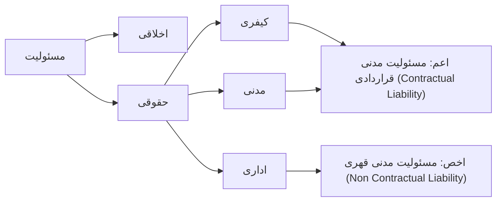

<!-- Source: civil-law-4-full.pdf, PDF pages 10-14 (printed pages 7 to 11); converted with LlamaParse agentic tier -->
## **جلسه ی دوم**

عقد مهم تر از ايقاع است چون چيزى تحت عنوان آزادى قراردادى وجود دارد (ماده ی ۱۰ ق.م) در حاليكه چنين چيزى در ايقاعات متناظراً وجود ندارد.

وفايع حقوقى = الزامات خارج از قرارداد = ضمان قهرى

در اين تقسيم بندى عقد بسیار حائز اهميت است اما آنچه كه مهم تر از عقد و يا هم عرض آن مى نمايد ، الزامات خارج از قرارداد يا ضمان قهرى است.

توضيح ساده ی دليل اين امر آن است كه تعداد افرادى كه طى روز توانائى وارد نمودن آسیب به ما را دارند يا توسط ما مورد آسیب قرار بگيرند منطقاً بسیار بيشتر از افرادى است كه توانائى انعقاد قرارداد با آنها وجود دارد. به همين علت است كه بيشتردعاوى در حوزه ی حقوق خصوصى (حدود ۷۰ درصد) مربوط به مقلوه ی وفايع حقوقى است.

اعتقاد حقوقدانان غربى بر اين است كه پيچيده ترین بخش حقوق خصوصى ، بخش مربوط به الزامات خارج از قرارداد (Tort) است. معنى لغوى "Tort" "كار نادرست است كه در زبان فارسى آرا تحت عنوان "مسئوليت مدنى" ميشناسيم.

در حقوق كارهاى نادرست يا همان مسئوليت مدنى برخى بيشتر بر منشاء اثر آن توجه داشته اند و دايरे ی شمول كارهاى را تعيين نموده اند كه انجام آنها ذيل مسئوليت مدنى قرار دارد و برخى ديگر در مقابل توجه بيشترى را بر نتیجه داشته اند. نظام حقوقى ما در دسته ی دوم قرار داشته و بيشتر بر نتیجه توجه دارد.

❖ الزامات خارج از قرارداد پيچيده ترین مفهوم حقوق خصوصى است و شمول گسترده ترى دارد.

**اركان الزامات خارج از قرارداد: ۱. ضرر(مفهومی عرفی) ۲. تقصير(تجاوز ار رفتار انسان متعارف) ۳. رابطه ی سببیت میان ضرر و ضرر(تشخيص آن عرفی است)**

### **مزيت و عيب ارجاع به عرف:**

مزيت ارجاع به عرف آنست كه عرف انعطاف بيشترى از قواعد مقرر دارد و دست ضابطه قضائى را باز تر ميگزد.

عيب ارجاع به عرف را ميتوان عدم وجود معيار مشخص و نبود دقت آن دانست كه كار ضابطه قضائى را در يافتن يك ضابطه ی واحد و دقيق دشوار ميسازد.

❖ همان طور كه اشاره شده مبحث الزامات خارج از قرارداد از آن جهت متضمن پيچيده ترین مفاهيم حقوقى هستند كه وجه لاييفك هر سه ركن آن وجود عنصر عرف است.

۷

---

برای تحقق مسئولیت مدنى قراردادى نیازمند وجود ۲ شرط هستیم:

۱. باید قرارداد معتبر و نافذی میان عامل زيان و زيان ديده موجود باشد(با اين معنا كه خسارت مربوط به زمان قبل از انعقاد عقد يا پس از انحلال آن نباشد)

۲. خسارت وارده ميبايستى بواسطه ی نقص تعهد مندرج در قرارداد باشد(مثلاً در صورت دعوى موجر و مستاجر و در بى آن تخريب ناگهانی يکی از اموال مستاجر توسط موجر، موجر داراى مسئوليت قراردادى <u>نيست</u> زيرا اين مسئله مربوط به قرارداد اجاره و تعهدات ناشى از آن نميشود)

اما مسئوليت مدنى قهری ناشى از نقص تكاليف عمومى است و تجاوز از رفتار انسان متعارف موجب خسارت گرديده است كه ناشى از تعهدات قراردادى نيست.

**سؤال ۱:** آیا در صورت وجود قرارداد امکان استناد به مسئوليت مدنى قهری و وجود دارد؟

**پاسخ ۱:** اصولاً اثبات مسئوليت مدنى قراردادى ساده تر است(نقص تعهدات قراردادى=تقصير). تعهدات قراردادى ۲ نوع هستند: ۱. تعهدات به نتیجه ۲. تعهدات به وسيله . علت سهولت بيشتر در اثبات تقصير در قراردادهای اين است كه غالب تعهدات قراردادى از نوع تعهد به نتیجه هستند و به همين دليل به محض عدم انجام تعهد و عدم حصول نتیجه ميتوان آنرا مصداق تقصير دانست. اين در حالى است كه در مسئوليت مدنى قهری ما با مفهوم "تجاوز از رفتار انسان متعارف" طرف هستیم كه تشخيص تحقق آن متضمن دشواری های بيشتری به علت روشن نيودن مصداق دقيق انسان متعارف است. بايد در نظر داشت كه دو تفاوت مهم در احكام دادرسى مسئوليت مدنى قهری و قراردادى وجود دارد:

**الف)** مرور زمان كه در مسئوليت مدنى قراردادى کوتاه تر و در مسئوليت مدنى قهری بلند تر است.

**ب)** صلاحيت محلى محاكم كه ۱. در مسئوليت مدنى قراردادى صلاحيت با دادگاه محل اقامت خوانده و محل انعقاد قرارداد است. ۲. در مسئوليت مدنى قهری صلاحيت دادسى با دادگاه محل وقوع ضرر يا حادثه خواهد بود.

۸

---

علمت اهمیت صلاحیت محاکم در احتمال وجود هزینه های مربوط به مسافت و رفت و آمد بر دوش طرفین دعوى است.

برای جمع بندى میتوان گفت: اصولاً امکان استناد به مسئولیت مدنى قهرى در هنگام وجود مسئوليت مدنى قراردادى در نظام حقوق تطبیقى منفى است اما آنرا نميتوان بدون استثناء دانست: مثلاً مسئوليت مدنى ناشى از توليد كالاى معيوب به جهت حمايت از منافع مصرف كنندگان.

اما در نظام حقوقى ما مطابق نظر دكتر كاتوزيان در مخالفت با نظام حقوق تطبیقى، اين مسئله مطرح گرديده كه به مادامى كه تعادل قراردادى به هم نريزد امکان استناد به مسئوليت مدنى قهرى وجود دارد.

**سوال ۲:** آیا مسئوليت قراردادى با ضمان قهرى (مسئوليت مدنى قهرى) متفاوت است يا وحدتى بنيادين دارند؟

**پاسخ ۲:** يك سرى تفاوت تفاوت بر شمرده شد مانند تفاوت در مورد تقصير كه برخى معتقدند لازم نيست در مسئوليت مدنى قراردادى به اثبات برسد كه البته نظر صحيحى نيست چرا كه سهولت اثبات به معنای عدم نیاز به اثبات نيست و در هر دو نوع از مسئوليت مدنى همچنان نیازمند اثبات تقصير هستيم. تفاوت ديگرى كه در مورد دو نوع مسئوليت مدنى مطرح شده اين است كه در مسئوليت مدنى قراردادى قابل پيش بينى بودن ضرر توسط بعضى از حقوقدانان در زمرة ی اوصاف ضرر قابل جبران آمده است اما اين قضيه در مورد مسئوليت مدنى قهرى صادق نيست. تفاوت آخر را نيز نميتوانان صحيح دانست، يك مثال قهرى براى اثبات خطاى اين نظر موجود است:

اگر (الف) چاهى بكند و (ب)، (ج) را به داخل آن هل بدهد، مسئوليت سقوط (ج) با (ب) خواهد بود اما اگر (الف) چاه را كنده و روی آنرا بپوشاند تا آنرا پنهان كند و سپس (ب)،(ج) را به داخل آن هل بدهد بايد (الف) را مسئول دانست.

با فرض صحت تفاوت آخر مربوط به قابل پيش بودن چطور ميتوان مثال بالا را توضيح داد؟

## **تقسيم بندى مسئوليت مدنى:**

نكته: در صورت استفاده از مطلق اصطلاح مسئوليت مدنى منظور همان مسئوليت مدنى قهرى است.

مسئوليت مدنى در حقوق غريبی

drawing: diagram showing three concentric circles with arrows pointing to labels for 'مسئولیت مدنی (معنای اعم)', 'ضمان قهری', and 'مسئولیت مدنی قهری'

(نظر غالب در حقوق ما بر نبودن دایره ی سبز رنگ است)

۹

---

برخی حقوقدانان معتقدند که ضمان قهری با مسئولیت مدنى قهرى متفاوت است(بى تردید این قضیه در حقوق غربى صحیح است اما پذیرش آن در نظام حقوقى ما جای تردید دارد) و ضمان قهرى شامل:۱. غصب و در حکم غصب ۲. اتلاف ۳. تسبیب ۴. استيفا ميشود اماممسئوليت مدنى فقط ميتواند شامل اتلاف و تسبیب باشد.

## **مسئوليت ادارى:** قانونى وجود دارد تحت عنوان قانون رسیدگى به تخلفات و نقض تکالیف ادارى که مربوط به تخلفات کارکنان اداره) و نه کارگران) است.

❖ از آنجا که نظام حقوقى ما در دوره ی اختلاط بسر ميبرد نميتوان تفاوت مشخصى میان مسئوليت مدنى و كیفرى قائل شد و آن ها را دو نوع متفاوت از هم دانست.

## **مبحث مبانى:**

**سوال ۳:** اساساً چرا بايد يك نفر خسارتى كه به ديگرى وارد ميكند را جبران كند؟

**پاسخ ۳:** صرف وارد كردن خسارت از طرف شخصى به ديگرى نميتواند موجبات الزام عامل زيان را به جبران خسارت فراهم كند چرا كه خسارت وارده بايد ناشى از تقصير يا خطاى وى باشد. اين موضوع را در فقه ميتوانون مستند به آيه چهلهم سوره ی شورى: "وَجَزَاءُ سَيِّئَةٍ سَيِّئَةٌ مِثْلُهَا" دانست كه لزوم وقوع تقصير(كارى نادرست) جهت الزام به جبران خسارت را تصديق ميكند.

**نظریه تقصير:** در مبحث مبانى اولين نظليه مطرحه، <mark>نظریه ی تقصير</mark> است.

زمانيكه نظام حقوقى فرانسه تدوين شد و جنبش قانون نویسى شكل گرفت ، بدواً قوانین هم رتبه با كنب مقدس تعبير و تفسير ميشدند و نظريه اى كه براى جبران خسارت مطرح شده بود، همين نظريه تقصير بود به اين علت كه تقصير مفهومى اخلاقى مستخرج از اخلاق مسيحيت و انديشه هاى فلسفى فلاسفه ی يونان بود.همچنين بايد دانست نظام فقهى ما تايد كنده ی اين نظريه است.

تقصير در اين نظريه دو ركن دارد:

۱. رخ دادن خطا(عنصر مادى) و ۲. خاطى از خطا بودن كارش آگاه باشد(عنصر معنوى)

مورد دوم را ميتوان با عنوان قابليت انتساب روانى نیز ناميد و به موجب آن از مجنون و صغير غير مميز سلب مسئوليت ميشد.

اين نظريه تا نیمه ی دوم قرن بيستم (۱۹۶۸) دوام آورد تا اينكه ركن قابليت انتساب روانى از آن سلب شد و اين مفهوم اخلاقى با مفهومى اجتماعى با معيار نوعى جایگزین گشت. اين به اين معناست كه رفتار صغير يا مجنون با انسان متعارف قياس و سنجيده ميشود و نه ساير صغار و مجانين.

۱۰

---

تا پایان قرن ۱۹ میلادی تنها مبنا برای تبیین مسئولیت مدنی خارج از قرارداد نظریه تقصیر بود. به چنین نظام هایی که این معیار واحد را برای احراز مسئولیت پذیرفته اند **وحدت گرا (Monist)** و به نظام هایی که چندین مبنا را برای اثبات مسئولیت لازم میدانند **تکثرگرا (Pluralist)** اطلاق میگردد. نظام حقوقی انگلیس تا اوایل قرن بیستم یک نظام پلورالیستی بود.

امروزه حقوق تطبیقی بر رویکرد بینایی استوار است و در هر موضوعی بنا بر اقتضای تشریحی با معیار وحدت گرا یا تکثرگرا مواجه میگردد.

<u>۱۱</u>
