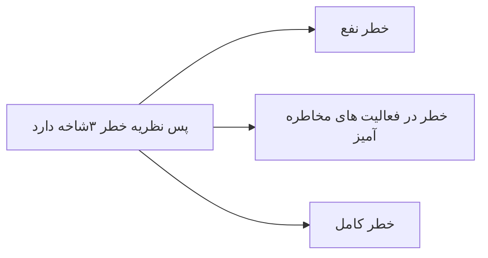

<!-- Source: civil-law-4-full.pdf, PDF pages 15-24 (printed pages 12 to 21); converted with LlamaParse agentic tier -->
## **جلسه سوم**

مبانی نظریه تقصیر: اندیشهِ فلاسفه یونان باستان نظریه تقصیر قبلاً مبنای اخلاقی داشت و معیار شخصی بود و به همین دلیل دو عنصر لازم داشت.

عناصر تقصیر: ۱) <u>خطا یا عنصر مادی</u> ۲) <u>آگاهی از خطا</u> یا عنصر معنوی یا روانی (آگاهی از فعل همان قابلیت انتساب روانی بود) تا سال ۱۹۶۸ چنین مفهومى بود با معیار شخصى که مفهوم اخلاقى بود.

نظام حقوقى فرانسه تا آن زمان وحدث گرا بود درمقابل كثرت گرا كه میان آن نظام بينايين يا مختلط قرار ميگيرد كه يك مبنای اصلى دارد و يك يا چند مبنای استثنایی برای تحمل مسئوليت مدنى .

با انقلاب صنعتى و اختراع اتومبيل در اواخر قرن ۱۹ نظریه تقصیر با انتقاداتی مواجه شد به دلايلی:

۱) اثبات تقصیر دشوار است (اینكه اثبات كنيم خطا كرده و مى دانسته كه كارش خطاست)

۲) در بسيارى از موارد اصلاً تقصيرى نيست اما خسارت به بار آمده هنگفت است

مثال دكتر كاتوزيان: فرزند كسى روى صندلى عقب خودرويش خوابيده و مجبورميشود ترمز بزند و سرش را بريميگرنداند كه وضعيت فرزند را چك كند و تصادف ميكند. آیا فرد تقصيركرده است؟ ایراد دوم ميگويد نه، اگر بگويميم نه بايد ببينيم در اثر تصادف چه خساراتى به بار آمده و آیا اشكال ندارد كه اين خسارت جبران نشده باقى بماند؟

تصادف با خودرو ممكن است مهلك باشد و آسیب زبادى بزند. امروزه قواعد و مقررات راهنمايى رانندگى داريم و به دنبال رفتار انسان متعارف نيستيم در گذشته اما اين قواعد نبوده و همچنان برخى از درشكه و اسب استفاده ميكردند و خودرو هاى تازه اختراع شده در آن زمان سنگين تر بوده اند و آسیب مهلكى وارد مى كردند.

انقلاب صنعتى كه موجب گسترش روابط كارگری و كارفرمائی بود در آن زمان حقوق كار وجود نداشت كه حداقل هاى رابه عنوان قواعد آمده به نفع كارگر مقرر كند تا كارفرما از مزيت ضعيف كارگر سواستفاده نكند.

در دوره اى كه چنين حقوقى وجود نداشت هر چقدر كارفرما ميگفت كارگر بايد كار ميكرد چون بیکارى بد بوده. در آن دوره تقصير ها را كارگر مرتكب ميشد و ممكن بود كارى كند كه كالاها معيوب شوند و سود اصلى در جيب كارفرما ميرفته.

---

نظریه تقصیر در اوامر قرن ۱۹ دچار چالش توسط ژوسرال و سالی شد. ژوسرال میگفت براى صحت قرارداد ها تنها يك شرط لازم است كه تراضى است و حرف دكتر كاتوزيان هم همين است. البته اينكه مهمترين است را قبول ميكنييم اما اينكه تنها شرط است را قبول نميكنييم.

در حوزه مسئوليت مدنى قهرى با سالى مقاله نوشتند و و نظريه تقصير را انتقاد كردند پيشنهاد نظريه ديگرى را دادند يعنى نظريه خطر را مطرح كردند يا نظريه خطر نفع/risk interest/منظورشان از نفع، نفع مادى است.

خطر نفع به اين معناست: هر كسى كه هر فعاليتى ميكند صرف نظر از اينكه مرتكب تقصير هست يا نه اگر از فعاليت سود مادى عايدش شود بايد خسارت ناشى از فعاليت را بدهد.

اينطورى تلاش كردند هر دويراد را بر طرف كنند.

نظرية خطر چند شاخه دارد كه يكى خطر نفع است.

گفتند منطقى تر است چون حقوق در واقع تعيين كننده قرار گرفتن نهايى خسارت است. يعنى اينكه نهايتا خسارت كجا قرار ميگيرد.

ما يك عامل زيان داريم و يك زيان ديده. ميان كسى كه كارى نكرده و كسى كه كارى كرده و فعل وى با ضرر رابطه سببيت دارد حقوق بايد تعيين كند كه ضرر كجا باشد بهتر است ضمنا فرد از فعلش نفع هم برده.

در فقه هم داريم: <mark>من له الغنم فعليه الغرم</mark> ظاهرا يعنى هركس كه سود مى برد غرامت هم بايد بر گردنش باشد اما در حقوق چنين نيست. در فقه اماميه قاعده اى داريم به نام الخروج بالضمان خروج يعنى منفعه و مال كسى است كه ضمان بر عهده وى است

دكتر كاتوزيان من له الغنم را براى خطر نفع به كار مى برد اما فقه اماميه اصلا آن را به اين منظور به كار نبرده است و فقه اماميه <mark>الخروج بالضمان</mark> به كار برده است.

الخروج بالضمان يعنى چه؟ كسى برده اى خریده بوده و از وى استفاده ميكند و سپس مى فهمد كه وى عيب داشته و معيوب بوده است و در اينجا خيار عيب را اعمال ميكند سپس ثمن را ميگيرد و برده را پس ميبهد بايع اعتراض ميكند كه از عبد چند روز استفاده شده است به پيامبر (ص) رجوع ميكند و پيامبر ميگويد الخروج بالضمان يعنى منافع اين چند روز مال كسى است كه اگر مال در دست او تلف ميشد از جيب مشترى ميرفت.

۱۳

---

الخراج بالضمان مربوط به قرار معوض صحیح است پس در واقع مربوط به ضمان معاوضی مى شود اما در اينجا بحث ما ضمان قهرى است ضمان قهرى يعنى فرد عوض مى دهد يا بدل مى دهد يا غرامت پرداخت مى كند اما ضمان معاوضى آن نيست. risk با liability متفاوت است. risk يعنى از جيب فرد مى رود مثلا كسى كه عقب عقب مى رود در پاركنگ و با در پاركنگ بر خود مى كند خودش مسئول است چون زيان است اگر liability باشد بايد بدل بدهد يا جبران خسارتى رخ بدهد يا تعهدى گردن كسى بيايد اما خود فرد نمى تواند به خودش تعهد داشته باشد. تعهد دو طرف دارد و غرامت يا compensation دارد.

نظر مسئوليت مدنى دكتر كانتوزيان چنين است كه هرگاه كسى در مقابل ديگرى تعهد به جبران خسارت داشته باشد.

الخراج بالضمان و من له الغنم فعليه الغرم در فقه اماميه يكى است و تنها كسى كه دو معنى مسئوليت دارد آن قائل شده مرحوم جعفرى لنگرودى است كه معلوم نيست چه مى گويد و ارجاعى به كتاب اصلى هم نداده.

نظرية خطر نفع تلاش مى كند كه روابط كارگرى و كارفرمائى را تنظيم كند و چون سود اصلى در جيب كارفرما مى رود او هم مسئول باشد. هدفش اين است اما منطق چندانى ندارد.

اين سوال مطرح شده كه آيا ميان منافع و ضمان تلازم بر قرار است؟ هر كس كه ضمان است منافع از آن اوست؟

مثال فقه اهل سنت: الف دابه اى اجازه مى كند از ب مى خواهد از كرج دنال بدهكار شود و ب كرج مى رود و ميبيند كه بدهكار آنجا نيست و مهرشهر است و بدون اينكه به موجر بگويد به آنجا مى رود و برميگردد و عين ماجرا را تعريف مى كند و دابه و اجرت را بر مى گيرد اند موجر مى گويد آن نكه كه اضافه رفته اى چه مى شود الف نميداند و نزد ابوحنيفه مى روند ابو حنيفه مى گويد وقتى از كرج رد شدى تخلف كردى و باعث مى شود كه يد امانى به يد ضمانى تبديل شود و ضمان عين ميشوى يد امانى وى تبديل به يد ضمانى ميشود يعنى مسئوليت وى مطلق ميشود absolute responsibility دارد يعنى ماده ۳۱۵ قانون مدنى ميشود: غاصب مسئول هر عيبى است كه در زمان تصرف او وارد شده باشد هر چند مستند به فعل او نباشد liability است و نه risk يعنى اگه قوه قاهره هم رخ داد و سنگ روی دابه مى افتاد و هيچ قصير هم نميكرد جز رد شدن از كرج وى مسئول است. ضمان يد است كه از موجبات ضمان قهرى است ابو حنيفه گفت الخراج بالضمان: وقتى تو ضمان عين هستى بابت منافع چيزى لازم نيست كه بدهى.

تلازمى ميان منفعت و ضمان وجود دارد. هر كس كه ضمان عين است منافع در جيب او مى رود اما گفتيم الخراج بالضمان مربوط به قرارداد هاى معوض صحيح است اما در اينجا هنگامى كه از كرج رد شده مسئوليت قراردادى نيست و خارج از قرارداد است و يد وى يد ضمانى است و امين نيست.

همين داستان را از امام صادق(ع) پرسيدند و گفتند اين حكم ها و فتوا ها موجب ميشوند كه بركت نباشد ما ميگويم وقتى از كرج رد شد هم ضمان عين است و هم منافع. تلازم ميان ضمان و منافع وجود ندارد و مال قرارداد هاى صحيح است و اگر از ما پيرسند

<u>۱۴</u>

---

که چرا لازم نیست در آن دوره چیزی ثابت منافع بدهد طبق گفته پیامبر(ص) پاسخ می‌دهیم که علت، مالکیت است هر کس مالک عین است مالک منافع هم هست و کسی که مالک نیست چیزی ثابت منافع به دیگری نمیدهد چرا ضمان است؟ چون مالک است. چرا منافع از آن اوست؟ چون مالک است اصل آن است که هرکس مالک عین است مالک منافع هم هست.

تلازمی میان خراج و ضمان نیست هر دو تابع مالکیت هستند اصل بر آن است که مال از جیب مالک میرود. توضیح ما برای بيع صحيح که الخراج بالضمان است اين است که هر دو تابع مالکیت هستند و ناظر به قرارداد باطل و الزامات خارج از قرارداد نیست. پس تلازمی میان غنم و غرم و میان منافع و ضمان وجود ندارد.

اگر حرف ابو حنیفه را بپذیریم تالی فاسد دارد و خود پیروان هم نمی‌پذیرند چون مثلا کسی که مانشین را فرض گرفته نا سر کوچه برود و برگردد میتواند بیشتر هم برود.

نابرده رنج گنج میسر نمیشود ضرب المثل مناسبی جهت تبیین قاعده حقوقی نیست.

## **الخراج بالضمان مربوط به حوزه قرارداد های صحيح معوض است**

من له الغنم فعليه الغرم در فقه امامیه با الخراج بالضمان یکی است هیچ کس حق ندارد من له الغنم فعليه الغرم را مساوی بگیرد با خطر نفع (دکتر کاتوزیان)

درباره الخراج بالضمان هشت نظر است که یکی نظر مشهور فقهای امامیه است ضمان یعنی ضمان معاوضی (نظدرست) در قرارداد های معوض خطر نفع سابقه ای در فقه امامیه ندارد در همان جا هم مورد انتقاد قرار گرفته که هیچ نظامی معتقد به آن نیست.

انتقاد: دو رانده با هم تصادف میکنند یکی دور دور میکند دیگری پول در می آورد نظریه خطر نفع میگوید آن کسی مسئول است که پول در می آورد در حالی که نظر ما چنین نیست اما خطر نفع میگوید آن کس که فعالیت میکند و از فعالیت نفع مادی می برد مسئول است. نظریه خطر نفع سریع کنار گذاشته شد.

\*خطر در فعالیت های غیر متعارف یا بیش از حد مخاطره آمیز: یعنی هرکس که فعالیت مخاطره آمیز انجام میدهد مثلا درباره هوش مصنوعی اتحادیه اروپا شیوه نامه دارد که بستگی دارد که بستگی دارد هوش مصنوعی را در چه فعالیتی به کار میگیریم مثلا خودرو های خودران فعالیت مخاطره آمیز است. اگر کسی فعالیت های مخاطره آمیز انجام داد مسئول است یعنی فعالیت مخاطره آمیز خودش تقصیر است هر چند ممکن است نباشد. خطر کامل / risk total: فرقی نمی‌کند که فعالیت چیست و باید خسارت ناشی از فعالیتش را پرداخت کند. تفکیکی قائل نیست.

۱۵

---

flow_chart

نظریه خطر در مقابل تقصیر در اوایقرن ۱۹ بیان شد و بسیار از آن استقبال شد.

فردی بود به نام ریپر که نظام حقوق فرانسه نیم قرن تحت تاثیر وی بود. کتابی دارد به نام فاعده اخلاقی در حقوق مدنی دلیل آن اخلاقی بودن وی بود که باعث شد مورد توجه قرار بگیرد.

ریپر، ژورسال و سالی را در جوانی ستایش میکند و میگوید مدیران تصفیه امور ورشکستگی نظریه تقصیر هستند (شخصیت حقوقی با تصفیه پایان می یابد)

بعدها از سه جهت نظریه خطر را با نظریه تقصیر مقایسه کردند

## **۱_از جهت اخلاقی ۲_از جهت اقتصادی ۳_از جهت تکنیکی/حقوقی**

**۱:** همیشه چنین نیست که یکی فعال و دیگری منفعل باشد. همیشه چنین نیست که فردی منفعل نشسته باشد و دیگری خسارت وارد کند مانند عملیات پزشکی

ممکن است حالت هایی متصور شود که دو طرف فعال هستند مثلاً یکی از خیابان رد میشود و دیگری رانندگی میکند

مثال فرانسوی ها: مثلا کسی پرده نصب میکند و کسی زیر پرده نشسته است و پرده در میرود و روی سر دیگری می افتد و میمیرد

اگر بگوییم چه تقصیر کرده باشد و چه نکرده باشد مسئول است ممکن است توان پرداخت خسارت نداشته باشد(آن گاه به جای یک بی نوا دو بی نوا داریم.) از نظر اخلاقی خوب نیست/همه شاخه های اخلاق هم یکی نیستند و اخلاق مبنای گوناگونی دارد

**۲:** از نظر اقتصادی: نظریه خطر نظریه بسیار بدی است. وقتی میگوییم risk یعنی بدون اینکه فرد تقصیرکرده باشد مسئولیت تحمل میشود! در جامعه ای که تولید وجود ندارد نظریه خطر خوب نیست.

دفعالیات اقتصادی را در دو کشور متفاوت با هم مقایسه میکنیم: همه چیز ثابت است جز نظریه تحمل مسئولیت ریسک کدام بیشتر است؟ آنجا که نظریه خطر است قیمت تمام شده در آنجا بیشتر است.

الف) خود به خود رقابت از بین میرود. ریسک اضافه میشود و قیمت تمام شده از جیب مشتری می رود و حمایت از کارگر منتفی میشود.

۱۶

---

ب) فردى که تولید کننده است تلاش میکند که ریسک ها را با بیمه پوشش دهد و روی قیمت ها آن را اضافه میکند و از جیب کارگر و مصرف کننده می رود.

پ) اگر ریسک ها زیاد شود به نحوی که ضرر ایجاد شود صاحب سرمایه تعطیل میکند.

سطح فعالیت کاهش می یابد یا تعطیل میشود. تعطیلی کارخانه به ضررکيست؟ به ضرر کارگر

از نظر اقتصادی هنگامى که قیمت تمام شده زیاد است امكان رقابت با باقى كشور ها از دست ميرود و به ضرر جامعه است و اوضاع تولید خراب میشود و همه به وارد کردن علاقه مند میشوند.

پس از نظر اقتصادی نظريه تقصير خيلى بهتر است و نظريه خطر هزينه ها را بالا می برد. البته در product liability اگر كالا معيوب باشد تولید کننده در مقابل مصرف کننده مسئول است؛ نظريه خطر تحمیل شده است.

۳: از نظر تكنيكي: اول گفتند نظريه خطر بهتر است چون اثبات تقصير از روند رسيدگی حذف می شود، دادگاه دیگر مسائل سخت نمیشود.

اما اگر نظريه تقصير مبنای مسئوليت مدنى باشد ميتوانيم ميان عوامل مختلف که دیگر بروز حادثه هستند فقط عواملى را مورد بررسی قرار دهيم که مرتكب تقصير شده اند.

در حالى که اگر تقصير حذف شود بايد همه عوامل لحاظ شود.

مثلا كسى از همت می پيچد در ميدان و تصادف میکند و اگر تقصير نباشد چند عامل در اين مسئله دخيل خواهند بود از جمله حتى كسى که مثلا به موبایل فرد زنگ زده است. باعث شدن يعنى رابطه سببیت وجود دارد.

آيا صرف تمرکز روی رابطه سببیت کار را ساده میکند از نظر تكنيكي يا آوردن تقصير هم کار را ساده تر میکند؟

قبل از اينكه به رابطه سببیت برسيم عنصر تقصير را داشتيم که هم کار را سخت میکند و هم موجب پالایش عوامل میشود. در حالى که وقتى تقصير را حذف كنيم تمرکز روی رابطه سببیت می رود يعنى اول بايد همه عوامل را بچينيم و بعد ببينيم رابطه سببیت دارد يعنى از نظر عرف خسارت به آن متناسب است در حالى که تقصير عنصر دوم است يا همان فعل زيانبار و اگر آن را حذف كنيم هر كس که هر كارى کرده است مسئول است به شرط اينكه رابطه سببیت وجود داشته باشد.

در اين صورت دادگاه دیگر عوامل متعدد بيشتری خواهد شد بدون نظريه تقصير.

سوال : آيا از نظر فنى دادرسى ساده تر میشود وقتى نظريه تقصير با نظريه خطر عوض میشود؟

اول چنين تصور ميشد که بله اما بعدا مشخص شد که نه.

<u>۱۷</u>

---

پس نظریه خطر در دنیا جایگزین نظریه تقصیر نشد اما دو اثر داشت: **۱-عدول ۲-تعدیل**

<u>۱: نظریه خطر</u> موجب شد از نظریه تقصیر استثناء عدول شود مثلا در حوادث رانندگی نظام حقوقی فرانسه از وحدت گرایبی خارج شد

<u>۲: موجب تعدیل نظریه تقصیر شد به دو شکل:</u>

الف: نظریه تقصیر را از مفهوم اخلاقی با معیار شخصی خارج کردند و گفتند اینکه آگاهی دارد که فعلش خطاست لازم نیست و قابلیت انتساب روایی لازم نیست و همین قدر که رفتارش با رفتار انسان متعارف مقایسه شود کافی است و معیار نوعی شد. پس تبدیل شد به مفهوم اجتماعی با معیار نوعی.

با این تعدیل اثبات تقصیر کار ساده تری شد چون تا قبل باید بررسی میشد که آیا فرد با آن اوصاف میداند که کارش خطاست یا خیر؟ اما پس از آن حتی رفتار دیوانه و صغیر غیر ممیز را با انسان متعارف مقایسه می کنیم.

ب: گاهی فرض تقصیر میگیریم مثلا در نظام حقوقی ما درباره پزشک فرض تقصیر وجود دارد. هرکجا اثبات تقصیر کار سختی شده قانونگذار تلاش کرده که فرض تقصیر کند مثلا برای فرد عادی اثبات تقصیر پزشک در عملیات درمانی دشوار است اگر خسارتی به بار آمد فرض اول آن است که پزشک تقصیر کرده است (presumption of fault) پس پزشک باید برای معافیت ثابت کند که مرتکب تقصیر نشده!

نظریه خطر در اوایل قرن ۱۹ به دو دلیل مطرح شد: **انقلاب صنعتی و اختراع اتومبیل**

با عدول استثنایی از نظریه تقصیر نظام حقوقی فرانسه از وحدت گرا به بینایی تبدیل شد در قرن ۲۰ میلادی نظام حقوقی انگلیس هم در قرن ۲۰ از کثرت گرا تبدیل به بینایی شد قبل از قرن ۲۰ کثرت گرا بود.

در حوزه tort، eng در tort های معین داشتیم که در عرض هم قرار داشتند تا قرن ۲۰ با مبناى معین مثل عقود معین، در گذشته شکل دعوا مهم بوده و هرکس ادعا داشته است اگر ادعایش منطبق با یکی از شکل های شناخته شده باشد میتوانست اقامه دعوا کند.

Negligence **شیبه تقصیر و تسبیب**

Nuisance **مزاحمت**

Tresspass **تجاوز به حق و جان**

Defamation **هتک حرمت و...**

۱۸

---

نظام کثرت گرایى بود که چند مبنای در عرض هم داشت که هیچ یک اصل و فرع نیستند: مبنای تحمیل مسئولیت مدنى

در ۱۹۳۲ ناگهان دعوى negligence زیاد شد و زیادى بزرگ شد که مبتنى است بر تقصير. رأى صادر شد و موجب شد که بقيه به اين فكر بيفتند که دعوى negligence زیادى بزرگ است. اين دعوا مبتنى است بر تقصير که چهار عنصر داشت که يکى از آنها <u>ضرر</u> بود و عنصر چهارم که موجب کوچک شدن اين دعوا شده بود حل شد: به معنى اثبات اينکه کسى در مقابل ديگرى وظيفه مراقبت دارد.

ما در نظام حقوقى ايران و فرانسه از تکليف عموى احتياط و مراقبت حرف ميزنيم اما در انگليس چنين چيزى نمى گوييم و ما تکليفى به شکل عام براى مراقبت نداريم.

اثبات duty of care تا ۱۹۳۲ سخت بود.

breach of duty of care باید اثبات ميشد، <u>loss</u>، <u>causation</u>، <u>duty of care</u> همگى بايد ثابت مى شدند. در سال ۱۹۳۲ دعواى میان استيونسون عليه دلاهيو مطرح شد استيونسون خانمى بود که به بار رفته بود و آبخو خريده بود و هنگامى که نصف آبخو را خورد فهميد که در شيشه آبخو حلزون است و بیمار شد. دختر عليه فروشنده اقاره دعوا کرد ليکن بايد دانست مسئوليت قراردادى نيست.

دادگاه از neighborhood theory استفاده کرد که ما نسبت به همسايه ها مسئوليت داريم همسايه کسى است که خيلى به ما نزدیک است و ممکن است از فعل ما دچار آسیب شوند.

تلاش قاضى اين بود که دایره شمول همسايه را کم کند اما برداشت عموى اين بود که ديگر نيازي به عنصر duty of care و دایره negilgence بزرگ شد.

از سال ۱۹۳۲ اسمش شد fault era : عصر تقصير

يعنى کثرت گرا ها هم در قرن ۲۰ تمایل پيدا کردند به نظام بينايين. تمایل نظام حقوق تطبيقى به نظام بينايين است.

نظر ديگرى هست که مال بوريس استارک به نام نظريه <u>تضمين حق</u>

بوريس استارک با اين جمله درخشان شروع کرد که انسان در عصر جديد نيازمند امنيت است

در نظريه تقصير و خطر تمرکز ما روی عامل زيان بود اما هنگامى که بوريس استارک ميگويد انسان نيازمند امنيت است تمرکزش روی زيان ديده است.

<u>۱۹</u>

---

توجه بوریس استارک به زیان داده و امنیت وی موجب برجسته شدن این نظر است. بوریس استارک گفت در عصر جدید ما حق داریم که کسی بی دلیل به ما آسیب نزند. این حق ایمن ماندن زیان داده با حق فعالیت عامل زیان در تعارض و تراضی قرار می‌گیرد.

مسئله های مسئولیت مدنی جای این تعارض ها و تراضی هاست و قانونگذار باید انتخاب کند.

اگر حق فعالیت را ترجیح داد کسی که فعالیت میکند نباید مسئول باشد مگر اینکه تقصیر کند اما اگر ایمن ماندن را ترجیح داد کسی که فعالیت کرده چه تقصیر کرده باشد و چه نکرده باشد باید خسارت زیان دیده را جبران کند.

مثلاً می‌توان به دیگری گفت که تو حق اعتصاب داری اما اگر کوچکترین ضرری برسد باید جبران شود این حق اعتصاب نیست!

یا مثلاً به تاجرى گفته شود حق رقابت با سایر تجار را دارد مشروط بر اینکه خسارتی به سایر تجار وارد نشود در حالی که رقابت یعنی مشتری‌های دیگری را جذب مغازه خودش کند.

پس اگر حق اعتصاب و رقابت داده شد در صورتی مسئول هستند که در فعالیتشان مرتکب تقصیر شده باشند مثلاً رقابت مکارانه یا اعتصاب خشن یا شورش.

حسن نظریه بوریس استارک:

۱-توجه به زیان داده

۲-توجه به نیاز به ایمنی در عصر جدید (از نگرانی‌های عصر حاضر)

۳- هم برای نظریه خطر جا باز می‌کند هم برای نظریه تقصیر

۴-نظریه بوریس استارک امکان توجیه انتخاب های قانونگذار را فراهم میکند

عیب بزرگ نظریه تضمین حق که حسن‌های آن را می‌پوشاند نظریه تضمین حق اصلاً نظریه نیست چون معیار روشنی برای انتخاب میان دو نظریه ارائه نمی‌دهد و گویی بوریس استارک به دنبال توجیه انتخاب‌های قانونگذار است در حالی که وقتی که ما نظریه می‌خواهیم فرض می‌کنیم که اصلاً قانون نداریم و می‌خواهیم قانون وضع کنیم بوریس استارک مثالی می‌زند و می‌گوید درباره خسارت‌های بدنی مانندن را انتخاب کنیم یا نظریه خطر. بعد درباره درد و رنج ناشی از خسارت‌های بدنی باید حق فعالیت و نظریه تقصیر را انتخاب می‌کنیم اما توضیح نمی‌دهد که چرا!

چرا خود خسارت با نظریه خطر اما درد و رنج ناشی از آن با نظریه تقصیر؟

نظریه تضمین حق یک نظریه دوگانه است که یک روی سکه خطر است و یک روی سکه تقصیر؛ اگر کسی بگوید مبنای نظریه ضمانت دید(غصب و در حکم غصب) تضمین حق است چه پاسخی باید داد؟

۲۰

---

چه در نظریه خطر و چه در نظریه تقصیر اگر قوه قاهره اثبات شود از مسئولیت معاف می‌شویم و رابطه سببیت لازم است در حالی که در ضمان يد رابطه سببیت لازم نیست.

دکتر کاتوزیان می‌گوید مبنای ضمان يد تضمین حق است که نظر درستی نیست چون در ضمان يد تقصیر نمی‌خواهیم و رابطه سببیت هم نمی‌خواهیم در حالی که تضمین حق یا تقصیر است یا خطر و وجه مشترکش رابطه سببیت است.

تضمین گروهی: در قرن ۲۰ مسئولیت مدنی با دو چالش مواجه بود ۱- گسترش بیمه
۲- جایگزین شدن مسئولیت جمعی به جای مسئولیت فردی

تضمین گروهی یعنی ممکن است من خسارت به بار آورده باشم اما چون همگی با هم قرارداد نوشته‌ایم که اگر خسارت توسط یکی از اعضای این جمع به بار آمد فرد جبران نکند و از پولی که همگی گذاشته‌اند جبران شود به قواعد مسئولیت مدنی کاری نداریم و دنبال جبران خسارتیم نه توسط یک فرد که توسط یک جمع و گروه.

بیمه‌ها و صندوق‌های جبران خسارت چینیان کاری می‌کنند خسارت از حق بیمه‌ها جبران می‌شود و یک فرد جبران نمی‌کند بلکه حق بیمه‌هایی که همگی گذاشته‌ایم جبران می‌کند.

قراردادی است میان زیان: این بخش قراردادی است مگر اینکه بگوییم متعهد به نفع ثالث است.

بیمه شخص ثالث تعهد به نفع ثالث است درست است که در انعقاد قرارداد نقشی نداشته است اما مثل کسی است که در انعقاد قرارداد نقش داشته است؛ فرق می‌کند با قرارداد و فرقش این است که باید خسارتی رخ دهد تا شخص شود که شخص ثالث کیست.

این چهار نظریه رویکرد سنتی به مسئولیت مدنی هستند.

رویکرد سنتی رویکرد گذشته نگری است که به دنبال جبران خسارت است. رویکرد مدرن به مسئولیت مدنی آینده نگر است و به دنبال این است که عوامل مسئولیت مدنی به گونه ای چیده شوند که خسارتی به بار نیاید. ممکن است از همین نظریات استفاده کند اما هدفش جبران خسارت گذشته نیست و هدفش این است که خسارت در آینده به بار نیاید چگونگی؟ ۱- سطح احتیاط بیشتر شود ۲- سطح فعالیت کمتر شود

رویکرد جذابی است! یکی از ایرادات حقوق این است که مفهوم عدالت روشن نیست. در رویکرد های جدید می‌گویند قوانین وقتی عادل‌انه است که هدف به بار نیامدن خسارت تامین شود.

پس مسئولیت مدنی وقتی عادل‌انه است که موجب کاهش حوادث شود (با عدد روشن میشود)

۲۱
